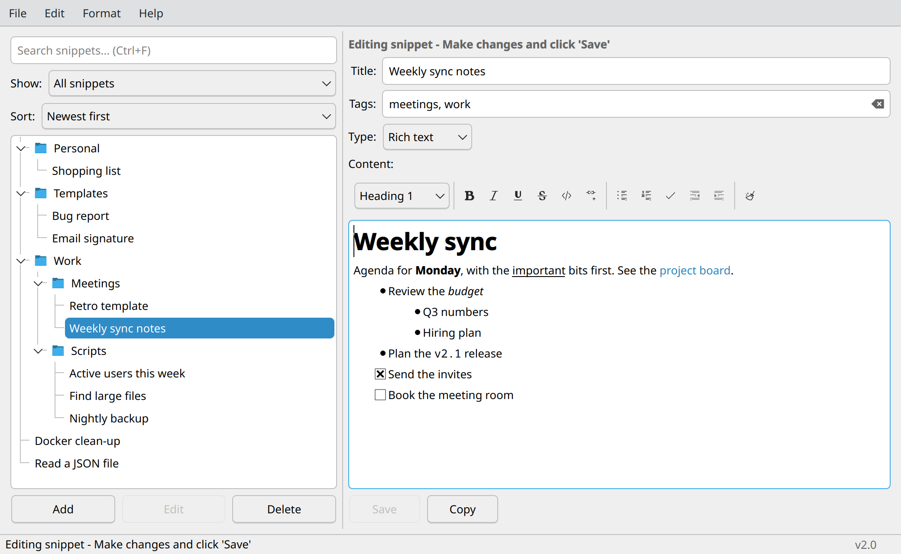
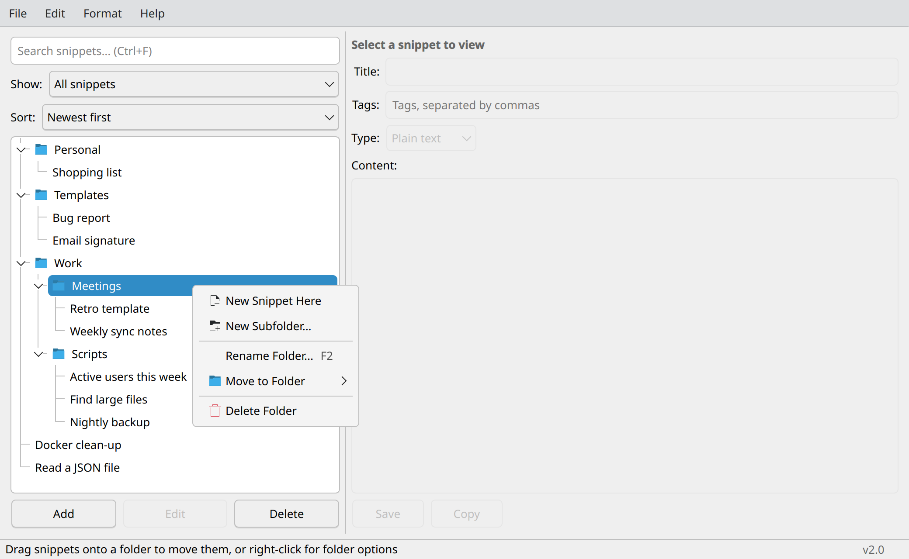
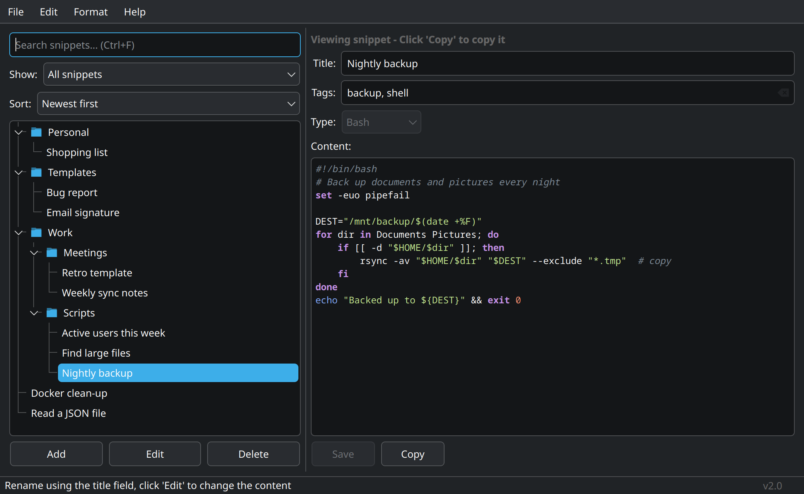
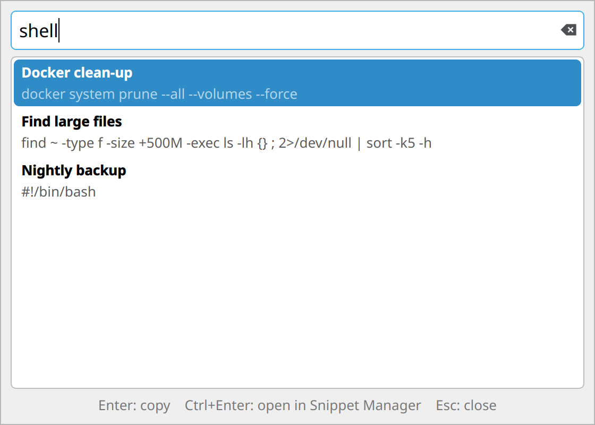
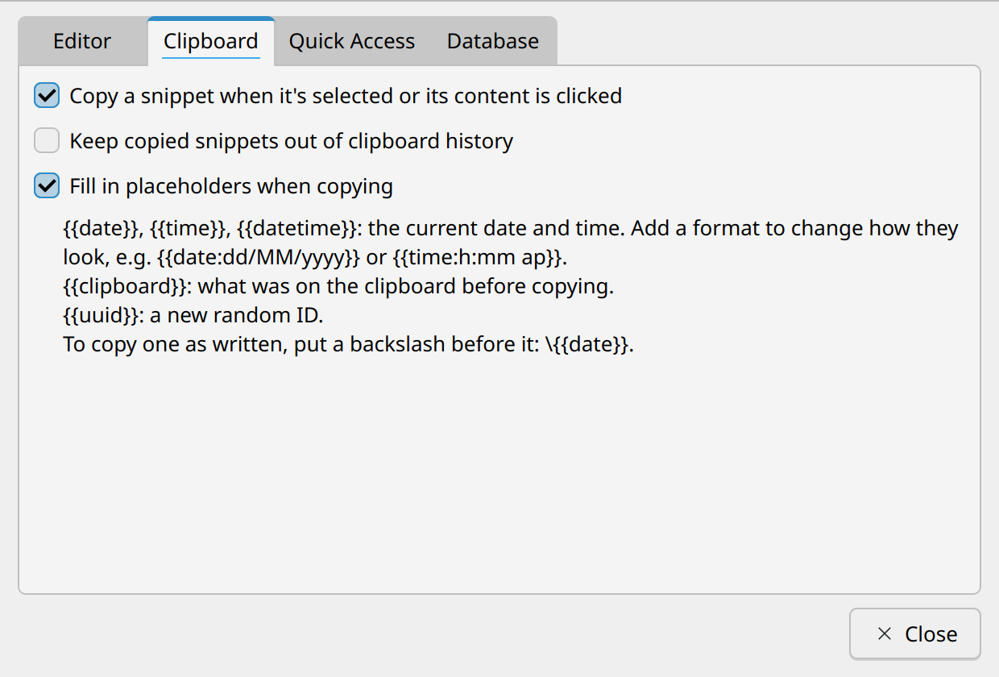

# Snippet Manager

**Current release: 2.0** — see [CHANGELOG.md](CHANGELOG.md) for what's new.

## Versions

- **2.0 (current)**: what this README describes, on `main`. 2.0 upgrades 1.x databases when it first opens them (keeping a backup copy), so you can move up without losing your snippets. Download it from [Releases](../../releases).
- **1.x**: the simple version, still available as release 1.3. It lives on the [`v1` branch](../../tree/v1) and gets bug and security fixes only.


### Background 
A very simple, very basic, KDE desktop application for storing and managing text snippets, code snippets, and short phrases with full Unicode support.

I couldn't find anything that suited my needs: Nothing fancy, just a dead simple, very basic desktop only snippets tools for storing strings, maybe some code, maybe some rich text. No server, no web ui, no per user licensing, no self-hosting, just a database with a gui front end that matches my KDE Plasma theme.

So I directed Claude to build it for me as my last coding was done 25 years ago and even then I've never done C or C++ coding before.

It's about 5000 lines of C++ and runs as a native QT6 application (supports themes) with a sqlite backend

Download and use the install script to compile it yourself, or use the AppImage or the  .deb or .rpms (build with github actions)

Used and tested on Fedora and CachyOs


> [!NOTE] 
> This is 99.9% vibe coded with Claude - originally with Amazon Kiro/Claude and then latterly directly with Claude Code (Opus 5.5)
> I haven't been a coder for about 20 years and even back it wasn't with C++. My C++/QT coding is basically ZERO 
> I have asked Claude to check this for security issues (for every build)  and I do have Dependabot running on this repo to keep track of any issues.
> But if vibe coded apps aren't your thing, this project isn't for you I'm afraid.


## Features

- **Add, Edit, Delete**: Full CRUD operations for text snippets, with a trash and undo
- **Search**: Fast, ranked search through titles, tags and content (matches part of a word)
- **Folders and tags**: Organise snippets in folders (drag and drop), and tag them across folders
- **Plain text, rich text or code**: A formatting toolbar and Format menu (headings, bold, italic, underline, strikethrough, code, links, bulleted, numbered and checklists), and syntax highlighting for code (both can be turned off)
- **Copy to Clipboard**: Select a snippet to copy it, with placeholders like `{{date}}` filled in
- **Quick search**: A popup from the tray or a global keyboard shortcut, to find and copy a snippet from any app
- **Import and export**: JSON, Markdown and CSV
- **Unicode Support**: Store and display any Unicode characters
- **SQLite Backend**: Self-contained database storage, private to your user account
- **Native KDE Integration**: Built with Qt, and KDE Frameworks when available

## Installing (Linux)

### Packages

Each [release](../../releases/latest) has ready-made packages:

| Distro | Install |
|---|---|
| **Arch, CachyOS, EndeavourOS, Manjaro** | From the AUR: `paru -S snippets-manager` (or `yay -S snippets-manager`). Or download the `.pkg.tar.zst` and run `sudo pacman -U snippets-manager-*.pkg.tar.zst` |
| **Fedora** | Download the `.rpm` and run `sudo dnf install ./snippets-manager-*.rpm` |
| **Ubuntu 24.04+, Debian 13** | Download the `.deb` and run `sudo apt install ./snippets-manager_*.deb` |
| **Any other distro** | Download the AppImage (see below) |

Packages install Snippet Manager for all users and add it to your application menu; your package manager removes it again. See [packaging/](packaging/) for how they're built.

### Install script

The install script builds the app from source and adds it to your application menu:

```bash
./install.sh --install-deps   # first time: also installs the build dependencies (apt, dnf, pacman or zypper)
./install.sh                  # build and install for the current user (into ~/.local, no sudo)
./install.sh --system         # or install for all users (into /usr/local, uses sudo)
./install.sh --uninstall      # remove it again (add --system if you installed with it)
```

Run `./install.sh --help` for all options. Uninstalling never touches your snippets database.

## Ready-to-run AppImage

`package-appimage.sh` builds a single self-contained file, with Qt bundled, that runs on other Linux machines without installing anything:

```bash
./package-appimage.sh
chmod +x SnippetManager-2.0-x86_64.AppImage
./SnippetManager-2.0-x86_64.AppImage
```

It builds inside an Ubuntu 24.04 container (it needs podman or docker), so the AppImage runs on Ubuntu 24.04 and newer, Debian 13, Fedora 40+ and current rolling distros, whatever you build it on. `./package-appimage.sh --native` builds with your own Qt instead, but the result then only runs on distros at least as new as yours. The AppImage uses the built-in syntax highlighting (see [Syntax highlighting](#syntax-highlighting)).

Running an AppImage needs FUSE 2 (`libfuse2`, `fuse2` or `fuse` depending on the distro); without it, run it with `--appimage-extract-and-run`.

 > [!NOTE]
>  I do not like Flatpaks (specifically the huge disk consumption of Flatpak runtimes) so I will never be making a Flatpak for this
>  Nor will I be making a snap for this either - snaps are worse than Flatpaks!
>  Therefore build from source or run download the appImage binary for X86_64 machines

## Building manually

### Prerequisites

- CMake 3.19+
- Qt 6.4+ (Core, Gui, Widgets, Sql with the SQLite driver, Network, and DBus on Linux)
- C++17 compiler
- Optional: KDE's KSyntaxHighlighting (KF6), for syntax highlighting of over 300 languages instead of the built-in 32

### Ubuntu/Debian
```bash
sudo apt install cmake build-essential qt6-base-dev libqt6sql6-sqlite
sudo apt install libkf6syntaxhighlighting-dev   # optional; Debian 13 / Ubuntu 25.04 and newer
```

### Fedora
```bash
sudo dnf install cmake gcc-c++ qt6-qtbase-devel kf6-syntax-highlighting-devel
```

### Build Steps
```bash
cmake -S ./ -B ./build
cmake --build ./build
ctest --test-dir ./build     # run the tests
```

### Run
```bash
./build/snippetmanager
```

Or just download the binary release from the releases page.

## Usage

1. **Adding Snippets**: Click "Add" (Ctrl+N) to create a new snippet
2. **Renaming and tagging**: The title and tags are always editable. Type a new title or some comma-separated tags and press Enter (or select another snippet) to save
3. **Editing Content**: Select a snippet, click "Edit" (Ctrl+E), make changes and click "Save" (Ctrl+S)
4. **Type and formatting**: While editing, pick Plain text, Rich text or a programming language (highlighted, in a fixed-width font). Plain and rich text snippets get a formatting toolbar above the content, with the same actions in the Format menu: paragraph style (normal text or headings 1-3, Ctrl+0 to Ctrl+3), bold (Ctrl+B), italic (Ctrl+I), underline (Ctrl+U), strikethrough, code, links (Ctrl+K), bulleted, numbered and checklists, indent and outdent (Tab and Shift+Tab in a list), and clear formatting. Using any of them on a plain text snippet turns it into rich text
5. **Searching**: Type in the search box (Ctrl+F) to find snippets by title, tags or content. Results are ranked by how well they match. Escape clears the search, and the Down arrow moves into the list
6. **Folders**: Right-click the list and choose "New Folder..." (or press Ctrl+Shift+N). Drag snippets onto a folder to move them there (or onto empty space to take them out), or right-click a snippet and choose "Move to Folder". Folders can go inside other folders. Right-click a folder to add a snippet or subfolder to it, rename it (F2) or delete it. Deleting a folder never deletes snippets: what was in it moves up a level. While searching, filtering by tag or looking at the trash, the list is flat, without folders
7. **Filtering**: Use "Show" to list all snippets, only untagged ones, only those with a tag, or the trash
8. **Sorting**: Use the "Sort" drop-down to order snippets by title (A-Z / Z-A) or by date created (oldest / newest first)
9. **Copying**: Selecting a snippet copies its content to the clipboard (rich text is copied with its formatting). Clicking anywhere in the content area copies it again (drag to select part of the text to copy just that part). Ctrl+Shift+C or the "Copy" button copies too
10. **Placeholders**: `{{date}}`, `{{time}}`, `{{datetime}}`, `{{clipboard}}` and `{{uuid}}` are filled in when a snippet is copied. Dates and times can take a format, like `{{date:dd/MM/yyyy}}`. Put a backslash before one to copy it as written: `\{{date}}`
11. **Details**: Right-click a snippet and choose "Details..." (or press Alt+Enter) to see when it was created and last changed
12. **Deleting**: Delete (or the Delete key in the list) moves a snippet to the trash. Ctrl+Z brings back the last one deleted. In "Show: Trash" you can restore snippets or delete them forever
13. **Quick search**: From the tray icon (middle-click), the global shortcut or `snippetmanager --popup`, a small window opens: type to find a snippet, press Enter to copy it, Ctrl+Enter to open it in the main window, Escape to close
14. **Import and export**: File > Import... reads JSON, Markdown and CSV files (CSV files from other apps work too: the columns are worked out from the header). File > Export... writes all your snippets, or just those shown, as JSON (best for backups), Markdown or CSV
15. **Settings**: File > Settings... has four tabs:
    - **Editor**: turn rich text editing or syntax highlighting off
    - **Clipboard**: copying on select, keeping copied snippets out of clipboard history (for clipboard managers that support it, such as KDE's Klipper), and placeholders
    - **Quick Access**: the tray icon, starting at login, and the global shortcut
    - **Database**: where the database is stored. Move it, open a different database, or create a new one

### Syntax highlighting

Code snippets are highlighted on every system, in one of two ways:

- **KDE's KSyntaxHighlighting**, when it's installed where Snippet Manager is built (for example with `./install.sh --install-deps` on Fedora, Arch, openSUSE, Debian 13 or Ubuntu 25.04 and newer). It knows over 300 languages and is very accurate.
- **The built-in highlighter** otherwise. It covers the 32 languages in the Type list (Bash, C, C++, C#, CSS, Go, HTML, Java, JavaScript, JSON, Python, Rust, SQL, TypeScript, YAML and others), colouring keywords, types, strings, comments, numbers, variables and tags, in colours that suit light and dark themes.

Why two? KSyntaxHighlighting is part of KDE Frameworks 6, which isn't available everywhere Snippet Manager runs. Ubuntu 24.04, which the AppImage is built on so that it runs on as many distros as possible, doesn't have it. Nor do standard Qt installs on Windows and macOS, where it would have to be built from source. Rather than leave those versions without highlighting, Snippet Manager has a small highlighter of its own that needs nothing beyond Qt. It's used whenever KSyntaxHighlighting isn't there, so every version highlights code. Settings > Editor shows which one your copy uses, and can turn highlighting off.

### The global shortcut

Turn on "Open the quick search with a keyboard shortcut" in Settings > Quick Access. Your desktop asks you to confirm the keys (Meta+Alt+V is suggested), and you can change them later in the desktop's shortcut settings. This uses the desktop's global shortcuts portal, which KDE Plasma 6, GNOME 48+ and Hyprland have. The app needs to be installed with `install.sh` (or have its menu entry added) for the desktop to recognise it.

On other desktops, or with the AppImage, add a custom shortcut in your desktop's keyboard settings that runs `snippetmanager --popup` (Settings > Quick Access shows the exact command). It opens the quick search in the copy that's already running.

## Data Storage

By default, snippets are stored in a SQLite database located at:
`~/.local/share/SnippetManager/Snippet Manager/snippets.db`

You can move it, or switch to another database file, from File > Settings.... The chosen location is remembered between runs.

The database file is only readable by your user account, because snippets often hold things like tokens and passwords. Snippet Manager won't open, or write to, a SQLite file that isn't a snippets database. Exported files are private to your account too.

When 2.0 first opens a 1.x database, it upgrades it and saves a copy of the original next to it (for example `snippets-v0-backup.db`). 1.3 can still open an upgraded database, but it doesn't show tags, folders or formatting, and it shows snippets that are in the trash.


## Screenshots

**Folders, tags and rich text.** Snippets live in folders (drag them in, or right-click for options) and can have tags. Rich text snippets get a formatting toolbar: headings, bold, italic, underline, links, lists and checklists.



**Folder options.** Right-click a folder to add a snippet or subfolder to it, rename it, move it or delete it.



**Code with syntax highlighting, in dark mode.** Code snippets are highlighted by language, in colours that follow your light or dark theme.



**Quick search.** Open it from the tray, a global keyboard shortcut or `snippetmanager --popup`, type a few letters and press Enter to copy.



**Settings.** Clipboard options, including placeholders like `{{date}}` that are filled in when a snippet is copied.



## Licence

Snippet Manager is free software, released under the [GNU General Public License, version 3](LICENSE) or (at your option) any later version. You can use, study, share and change it; if you distribute a changed version, it must be under the same licence, with its source code available.
